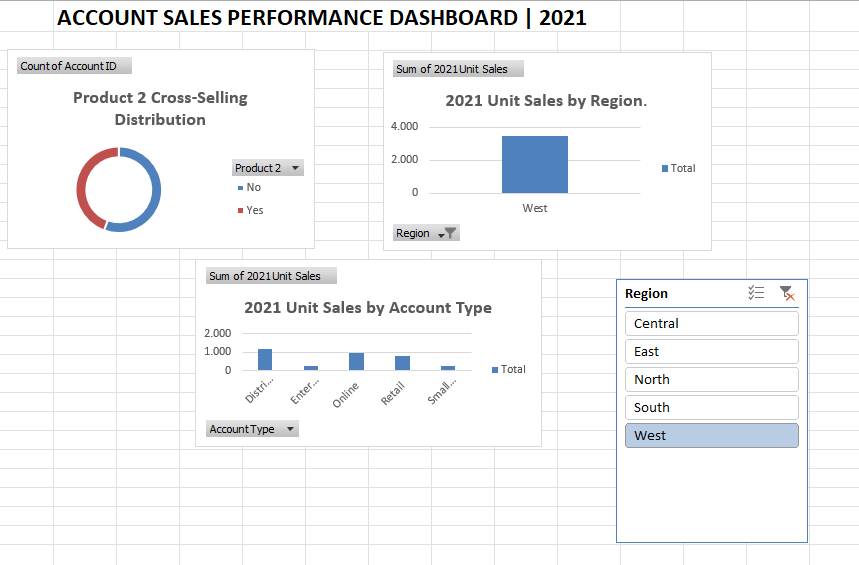

# Excel Sales Performance Dashboard

### Project Overview
## Dashboard Preview

Developed an interactive sales performance dashboard in Microsoft Excel to analyze historical sales data across 40 customer accounts.

The project focuses on evaluating sales performance across customer segments and geographical regions, identifying cross-selling opportunities, and presenting business insights through interactive visualizations.

The analysis was completed using a practice dataset from the Forage Excel Skills simulation, with additional PivotTable analysis and dashboard development.

## Tools & Skills Used

- Microsoft Excel
- PivotTables and PivotCharts
- Excel Formulas
- Conditional Formatting
- Interactive Slicers
- Data Analysis and Visualization
- Business Performance Reporting

## Analysis Performed

### 1. Sales Performance by Account Type

Analyzed 2021 unit sales across five customer categories to identify the highest-performing segments.

**Key Finding:** Online accounts generated the highest sales volume, contributing 5,140 units out of 17,278 total units sold in 2021.

### 2. Regional Sales Performance

Used PivotTables and PivotCharts to compare sales performance across five geographical regions.

**Key Finding:** The South region recorded the highest sales volume, with 4,756 units in 2021, while the North region recorded the lowest volume at 2,434 units.

### 3. Product Cross-Selling Analysis

Evaluated Product 2 adoption across 40 customer accounts.

**Key Findings:**

- 24 accounts (60%) had Product 2.
- 16 accounts (40%) did not have Product 2.
- Identified 16 accounts as potential cross-selling opportunities.

### 4. Interactive Excel Dashboard

Developed an interactive dashboard combining sales performance charts and product adoption analysis.

Implemented a Region slicer to filter connected PivotCharts and compare performance across different geographical markets.

## Key Business Insights

The analysis highlighted differences in customer segment performance, regional sales distribution, and product adoption.

Online accounts represented the largest customer segment by 2021 unit sales, while the South region demonstrated the strongest regional sales volume.

The cross-selling analysis also identified opportunities to investigate Product 2 adoption among existing accounts.

## Skills Demonstrated

This project demonstrates practical experience in organizing business data, building PivotTables, interpreting sales performance metrics, and developing interactive Excel reports.

These techniques are relevant to business analytics, sales controlling, operational reporting, and performance monitoring.

## Project Context

This project uses a training dataset provided through the Forage Excel Skills job simulation.

The dashboard and additional analysis were developed independently for learning and portfolio purposes.

All results reflect simulated business data rather than actual company performance.
